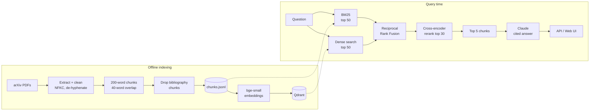

# Hybrid-Search RAG with Reranking

[](https://github.com/dot-hpg/rag-hybrid-search/actions/workflows/ci.yml)
[](https://github.com/dot-hpg/rag-hybrid-search/actions/workflows/benchmark.yml)


A question-answering system over 24 landmark ML papers (Transformer, BERT, GPT-3, LoRA,
RAG, ...) that combines **keyword search (BM25)** and **semantic search (dense embeddings
in Qdrant)**, merges them with **reciprocal rank fusion**, reorders the candidates with a
**cross-encoder**, and has **Claude** write an answer that cites its sources. A labelled
benchmark measures what each stage adds.

* **Retrieval:** custom vectorised BM25, `bge-small-en-v1.5` embeddings in Qdrant, RRF, `ms-marco-MiniLM` cross-encoder
* **Generation:** streamed, cited answers from Claude, with an LLM-free extractive fallback
* **Serving:** FastAPI (REST + server-sent events) with a built-in web UI that compares retrieval modes side by side
* **Evaluation:** 60 labelled questions, Hit@k / MRR / nDCG / recall with bootstrap confidence intervals, latency per stage, and ablations over embedders, rerankers, fusion and rerank depth
* **Engineering:** typed, tested (55 tests, 91% coverage), CI on 3 Python versions, Docker image with the index baked in, one-click Hugging Face Spaces deploy

## Results

Retrieval quality on 60 hand-labelled questions (2,025 chunks from 24 papers). Higher is
better; best value per column in bold.

<!-- RESULTS:START -->
| Retrieval | Hit@1 | Hit@5 | MRR@10 | 95% CI | nDCG@10 | Recall@10 | p50 ms | p95 ms |
|---|---:|---:|---:|---:|---:|---:|---:|---:|
| BM25 | 0.400 | 0.750 | 0.553 | 0.45-0.66 | 0.530 | 0.695 | 0.1 | 0.1 |
| Dense (bge-small) | 0.217 | 0.667 | 0.403 | 0.32-0.50 | 0.382 | 0.545 | 30 | 109 |
| Hybrid (RRF) | 0.417 | 0.750 | 0.562 | 0.46-0.66 | 0.515 | 0.656 | 36 | 58 |
| Dense + rerank | **0.467** | 0.750 | 0.574 | 0.47-0.69 | 0.524 | 0.653 | 2074 | 2277 |
| **Hybrid + rerank** | **0.467** | **0.817** | **0.600** | 0.50-0.71 | **0.568** | **0.735** | 1968 | 2318 |

MRR@10 by question type:

| Retrieval | lexical (n=27) | semantic (n=33) |
|---|---:|---:|
| BM25 | 0.570 | 0.538 |
| Dense (bge-small) | 0.525 | 0.303 |
| Hybrid (RRF) | 0.673 | 0.470 |
| Dense + rerank | 0.651 | 0.510 |
| **Hybrid + rerank** | 0.669 | 0.543 |

<sub>60 labelled questions over 2025 chunks · embeddings `BAAI/bge-small-en-v1.5` · reranker `cross-encoder/ms-marco-MiniLM-L-6-v2` · candidates 50/retriever, RRF k=60, rerank depth 30 · latency is retrieval only, CPU (x86_64) · generated 2026-10-27T04:31:35Z</sub>
<!-- RESULTS:END -->

**What the numbers say**

* **The full pipeline wins.** Hybrid + rerank puts a relevant passage in the top 5 for
  82% of questions, against 75% for BM25 and 67% for dense search alone, and has the
  best MRR, nDCG and recall. Its MRR interval (0.50-0.71) doesn't overlap dense's (0.32-0.50).
* **BM25 is a strong baseline on technical text.** Papers are full of rare exact tokens
  (model names, numbers, acronyms) that keyword search matches perfectly. The small
  embedding model is the weakest single retriever, even on paraphrased questions.
* **Fusion alone isn't enough; fusion plus reranking is.** RRF lifts lexical questions
  (MRR 0.57 → 0.67) but the weaker dense list adds noise on semantic ones. The
  cross-encoder turns the larger, more diverse candidate pool into precision: it's the
  only configuration at least as good as BM25 on both question types.
* **The reranker is where the latency goes.** Retrieval takes ~35 ms; scoring 30
  candidates with the cross-encoder takes ~2 s on a 4-vCPU runner with no GPU. Ablations
  show quality plateaus at depth 30, and a 12× larger reranker (`bge-reranker-base`) adds
  another +0.06 MRR (Hit@5 0.85) at 6× the latency, a good trade only on a GPU.

How the questions, labels and metrics work: [docs/evaluation.md](docs/evaluation.md).
The table is regenerated by the [Benchmark workflow](.github/workflows/benchmark.yml) on a
clean GitHub runner, not edited by hand.

### Ablations

From [results/ablations/README.md](results/ablations/README.md), all on the same 60 questions (hybrid + rerank unless noted):

| Change from the default | Hit@5 | MRR@10 | p50 latency |
|---|---:|---:|---:|
| **Default:** bge-small + MiniLM-L6 reranker, RRF k=60, depth 30 | 0.817 | 0.600 | 2.4 s |
| Embedder → `bge-base-en-v1.5` (3× larger) | 0.817 | 0.591 | 2.4 s |
| Embedder → `all-MiniLM-L6-v2` | 0.817 | 0.594 | 2.5 s |
| Reranker → `bge-reranker-base` | **0.850** | **0.661** | 14.6 s |
| Rerank depth 10 / 20 / 50 | 0.783 / 0.783 / 0.800 | 0.589 / 0.591 / 0.600 | 0.7 / 1.5 / 4.0 s |
| RRF k = 10 / 30 / 100 | 0.800 / 0.817 / 0.817 | 0.599 / 0.600 / 0.600 | same |
| Min-max score blending instead of RRF | 0.800 | 0.599 | same |

A bigger embedder helps dense search on its own (MRR 0.40 → 0.49) but almost nothing
once the reranker runs, so the small one stays. RRF's `k` barely matters here, and plain
score blending does about as well on this set; RRF stays the default because it needs no
score normalisation or tuning when a retriever is swapped.

## Architecture



| Stage | Why it's there |
|---|---|
| BM25 | Catches exact terms embeddings blur: numbers, acronyms, model names ("SwiGLU", "28.4 BLEU") |
| Dense | Catches paraphrases with no word overlap ("arbitrary word" vs "random token") |
| RRF | Merges both by rank, so their incompatible score scales never have to be calibrated |
| Cross-encoder | Reads query and passage together; much more precise, so it's spent only on the 30 best candidates |
| Claude | Answers only from the numbered sources and cites them inline, or says the sources don't cover it |

The trade-offs behind each choice (chunk size, RRF vs score blending, rerank depth, why
BM25 is hand-written, the bibliography filter, ...) are in [docs/design.md](docs/design.md).

## Quickstart

Requires Python 3.11+. On Windows, use PowerShell and `.venv\Scripts\Activate.ps1`.

```bash
git clone https://github.com/dot-hpg/rag-hybrid-search.git
cd rag-hybrid-search
python -m venv .venv && source .venv/bin/activate

# CPU-only torch is ~200 MB instead of ~2 GB; skip this line if you have a GPU
pip install torch --index-url https://download.pytorch.org/whl/cpu
pip install -e ".[ml,dev]"

rag index          # embed the 2,025 chunks into Qdrant (~1-2 min on CPU)
rag serve          # http://localhost:8000
```

The chunked corpus ships in `data/processed/chunks.jsonl`, so no PDF download is needed.
To rebuild it from the PDFs: `rag download && rag ingest`.

For Claude-written answers, set `ANTHROPIC_API_KEY` (in your shell or in `.env`, see
[.env.example](.env.example)). Without it, answers are extractive: the best-matching
retrieved sentences, cited.

### Docker

```bash
docker build -t rag-hybrid-search .          # downloads models and builds the index
docker run -p 7860:7860 -e ANTHROPIC_API_KEY rag-hybrid-search
# or, with a standalone Qdrant server:
docker compose up --build
```

Deploying a free public demo on Hugging Face Spaces is automated by a GitHub workflow; setup takes a few minutes:
[docs/deployment.md](docs/deployment.md).

## Usage

### CLI

```bash
rag search "How does LoRA reduce the number of trainable parameters?" --mode hybrid_rerank
rag ask "Why do models miss information in the middle of long contexts?"
rag eval --update-readme          # benchmark every mode, refresh the table above
```

Modes: `bm25`, `dense`, `hybrid`, `dense_rerank`, `hybrid_rerank` (default).

### API

Interactive docs at `/docs`.

```bash
curl -s localhost:8000/api/ask -H 'Content-Type: application/json' \
  -d '{"query": "What is 4-bit NormalFloat?", "mode": "hybrid_rerank", "k": 5}'
```

| Endpoint | Description |
|---|---|
| `POST /api/search` | Top-k chunks for a query, with per-stage ranks and timings |
| `POST /api/compare` | The same query through every retrieval mode |
| `POST /api/ask` | Cited answer plus its sources |
| `POST /api/ask/stream` | The same, streamed as server-sent events (`sources`, `token`..., `done`) |
| `GET /api/info`, `/api/papers`, `/health` | Metadata and health check |

Every hit reports where it came from, e.g. `"ranks": {"bm25": 7, "dense": 1, "fused": 2, "rerank": 1}`,
which makes it easy to see what fusion and reranking changed.

### Web UI

Served at `/`: ask a question, watch the answer stream in, click a citation to jump to its
source, and tick **compare all modes** to see the top results of every retrieval mode
side by side, with a per-stage latency bar.

## Project structure

```
src/hybrid_rag/
├── config.py            settings from env vars / .env (RAG_ prefix)
├── corpus.py            the 24 papers, chunk file I/O
├── types.py             Chunk, ScoredChunk
├── ingest/              arXiv download, PDF extraction, chunking, bibliography filter
├── retrieval/           bm25.py, dense.py (Qdrant), fusion.py (RRF), rerank.py
├── generation/          Claude (streaming, citations) and extractive fallback
├── pipeline.py          retrieve → fuse → rerank → generate, with stage timings
├── eval/                labelled questions, metrics, benchmark runner
├── api/                 FastAPI app and the static web UI
└── cli.py               `rag` command
data/processed/          chunks.jsonl, the corpus
data/eval/               questions.jsonl, the benchmark
tests/                   unit + API tests (stand-in models), slow model tests
docs/                    design.md, evaluation.md, deployment.md
```

## Development

```bash
make test      # pytest with coverage; uses fast stand-in models, no downloads
make lint      # ruff + mypy
pytest -m slow # tests against the real embedding and reranking models
```

CI runs lint, type checks and tests on Python 3.11-3.13, then builds the Docker image and
smoke-tests the running container.

## License

MIT
